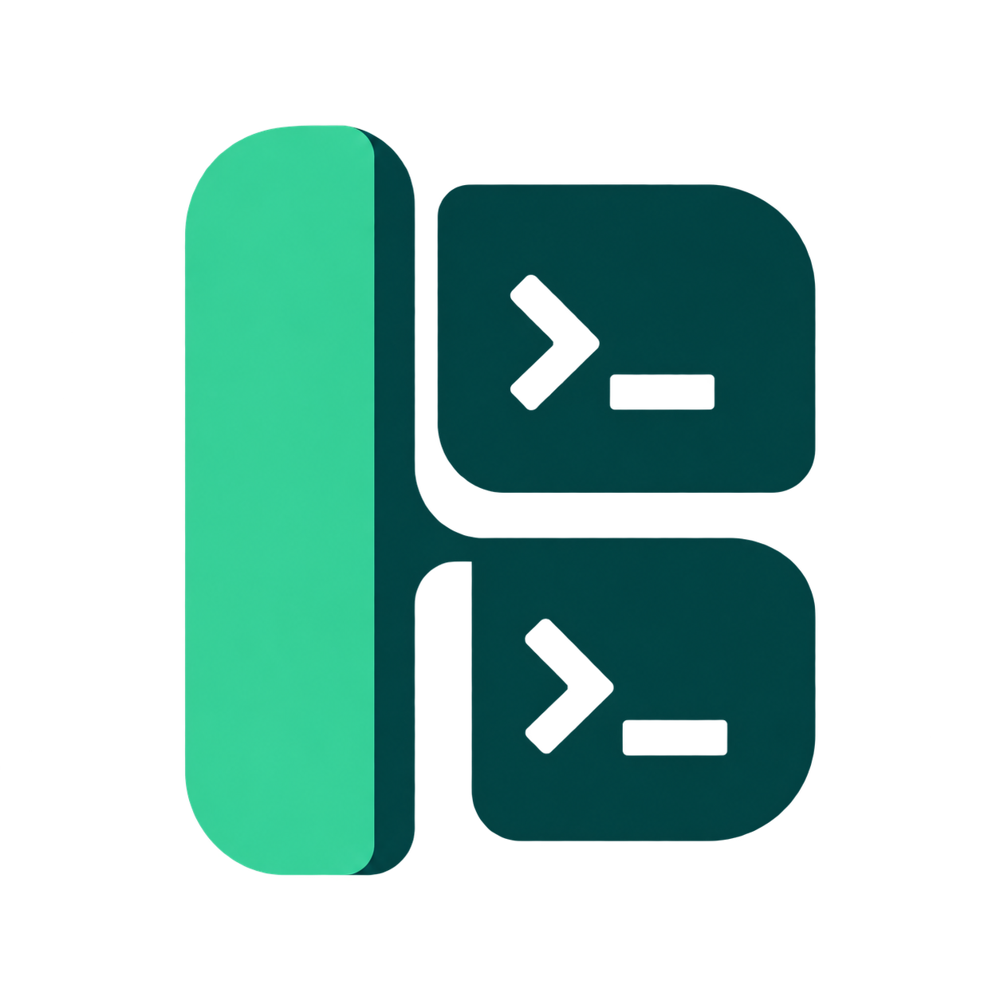
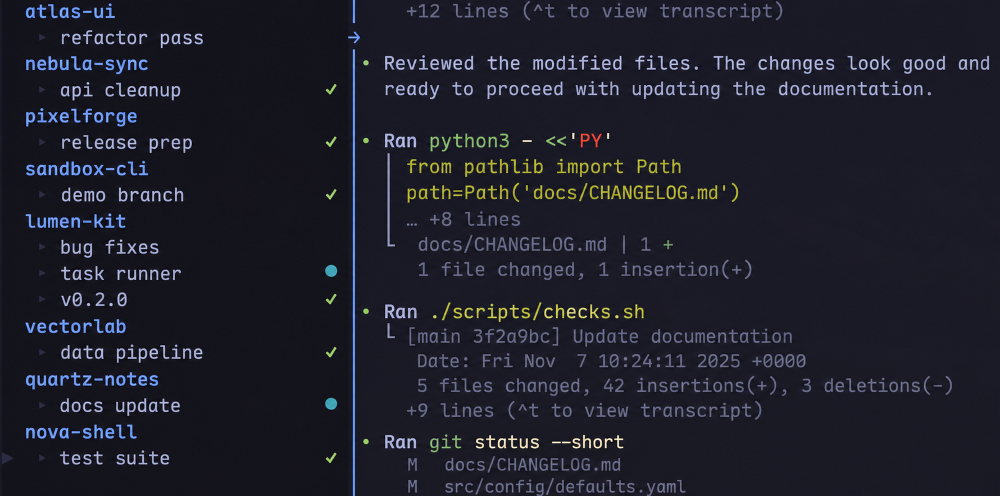

<p align="center">
  <sub>Originally forked from <a href="https://github.com/sandudorogan/tmux-pane-tree">tmux-pane-tree</a> by Sandu Dorogan.</sub>
</p>

<p align="center">
  <picture>
    <source media="(prefers-color-scheme: dark)" srcset="assets/logo-dark.png">
    <source media="(prefers-color-scheme: light)" srcset="assets/logo-light.png">
    
  </picture>
</p>

<h1 align="center">tmux-binder</h1>

<p align="center">
  <em>One sidebar. Every session.</em>
</p>

<p align="center">
  <a href="https://github.com/illegalstudio/tmux-binder/actions/workflows/test.yml"></a>
  <a href="#installation"></a>
  <a href="#installation"></a>
  <a href="LICENSE"></a>
</p>

<p align="center">
  <strong>Live navigation &middot; Global visibility &middot; Agent activity</strong>
</p>

<p align="center">
  Keep your sessions, windows and panes within reach. Browse live previews,
  carry one shared sidebar across tmux, and see which coding agents are working,
  waiting for you or finished.
</p>

<p align="center">
  <a href="https://illegal.studio/en/products/tmux-binder"><strong>Official website</strong></a>
</p>

---

[Installation](#installation) · [Navigation](#navigation) · [Agent activity](#agent-activity) · [Configuration](#configuration) · [Development](#development)



## Your workspace at a glance

```text
  work
   ▸ api                         ?1 ●2
▶  ▸ worker                          ●
  ops
   ▾ deploy                          ✓
     codex                           ✓
```

- **Preview as you browse.** Move through windows and panes to see their contents immediately. Keep navigating in the sidebar, then press Enter to work in the selected pane.
- **Open once, use everywhere.** Visibility is shared across existing and future sessions and windows, including detached sessions. Closing one sidebar closes them all.
- **See activity without expanding.** Window summaries show agent activity even with their pane lists collapsed. Expand a window to see each pane's state.
- **Keep your layout.** The sidebar remembers its preferred width across navigation, reopening and clients with different terminal sizes. Content processes keep running when the sidebar reloads.
- **Stay inside tmux.** Search, Unicode names, keyboard shortcuts and native context menus fit into your terminal workflow. Selection and accents follow your tmux theme.

## Installation

Requires **tmux 3.4+**, **Python 3.10+ with curses**, and **Bash**. The runtime uses the Python standard library, with no pip packages to install.

### With TPM

Add this alongside your plugins in `~/.tmux.conf`, before the TPM initialization line:

```tmux
set -g @plugin 'illegalstudio/tmux-binder'
```

Reload your tmux configuration, then press **prefix + I** to install. Press **prefix + t** to open the sidebar.

### Manual installation

```bash
git clone https://github.com/illegalstudio/tmux-binder \
  ~/.config/tmux/plugins/tmux-binder
```

Add this to your tmux configuration, then reload it:

```tmux
source-file ~/.config/tmux/plugins/tmux-binder/tmux-pane-tree.conf
```

The `tmux-pane-tree.conf` filename and `@tmux_pane_tree_*` option names remain compatible with the original plugin. Legacy `@tmux_sidebar_*` options and shell entrypoints are also supported.

**Agent hooks are optional and disabled by default.** Installing the sidebar does not modify agent settings. Follow [Connect your agents](#connect-your-agents) to enable activity indicators.

## Navigation

| Key | Action |
| --- | --- |
| **prefix + t** | Open or close the sidebar everywhere |
| **prefix + T** | Focus the sidebar or return to the content pane |
| `j` / `k`, Up / Down | Move selection and preview the selected content |
| `gg` / `G` | Jump to the first or last selectable item |
| `Enter` | Focus the selected content pane |
| `Ctrl+l` | Return to the content pane |
| `l`, Right, `+`, `=` | Expand the selected window's panes |
| `h`, Left, `-` | Collapse the selected window's panes |
| `/` | Search sessions, windows and panes |
| `n` / `N` | Move to the next or previous search match |
| `Ctrl+o` / `Ctrl+i` | Go back or forward through the jump list |
| `aw` / `as` | Add a window or session |
| `r` / `R` | Rename the selected window or its session |
| `x` | Close the selected item, with confirmation for headers |
| `f` | Toggle the configured pane filter |
| `p` | Toggle pane rows |
| `m` / right click | Open the native context menu |
| `q` | Close the sidebar everywhere |

Window branches start collapsed. Session headings stay visible and keyboard navigation skips them, so every window remains reachable. Expanding a window persists across navigation and reloads; new windows start collapsed. Searching reveals matching pane rows automatically.

Live preview follows selection between sessions, windows and panes, keeping keyboard focus in the sidebar. Search, expanded branches, scroll and jump history follow you. Browsing a pane that needs input keeps its attention indicator until you actually focus the content.

Names are entered in the sidebar. Use `Ctrl+u` to clear a prompt and Escape to cancel. Native context menus also expose pane splitting, zoom, marking, moving a pane into a new window and detaching session clients.

When the last content pane exits, Binder removes its now-empty window and moves
you to live content, preferring another window in the same session and then
another session. Existing windows containing only the sidebar are skipped.
Exiting the last working pane on the server detaches the client.

To browse without switching content until Enter:

```tmux
set -g @tmux_pane_tree_live_preview off
```

## Agent activity

Integrations are available for **Claude Code, Codex, Cursor Agent, OpenCode, Pi, Kiro and Grok**.

| Indicator | State | Meaning |
| :---: | --- | --- |
| `●` | Running | The agent is working |
| `↳` | Delegating | Subagents are active |
| `?` | Needs input | The agent is waiting for permission or input |
| `!` | Error | An error was reported |
| `✓` | Done | The agent finished its turn |

Indicators are monochrome symbols that need no special font. On 256-color terminals, activity uses cyan, input yellow, errors red and completion green. Badges retain their colors on the selected row's tmux background.

Every window summarizes all of its content panes, even when collapsed or filtered. `?1 ●2` means one pane needs input and two are working. When every state occurs once, symbols appear without counts. Counts refer to panes, not the number of subagents.

Focusing a pane clears its `?` state. Completion stays visible until the next run.

### Connect your agents

Run the installer from the plugin directory, selecting the integrations you use:

```bash
cd ~/.config/tmux/plugins/tmux-binder
bash scripts/features/hooks/install-agent-hooks.sh \
  --agent claude --agent codex
```

For TPM installations, use the plugin directory chosen by TPM, commonly `~/.tmux/plugins/tmux-binder`. Accepted agent names are `claude`, `codex`, `cursor`, `opencode`, `pi`, `kiro` and `grok`.

The installer updates existing Binder hooks, migrates recognized older paths and removes duplicates. It preserves other integrations, existing file permissions and symlinks, and keeps up to three timestamped backups per configuration file.

**Codex:** open `/hooks` and review and trust the new definitions. Existing trust settings are preserved; installation does not bypass review. See the [official Codex hook documentation](https://learn.chatgpt.com/docs/hooks). Already-running agents may need their hooks reloaded or a new agent session before they emit events.

To install or update hooks automatically whenever the plugin loads:

```tmux
set -g @tmux_pane_tree_install_agent_hooks 1
```

This mode, and running the installer without `--agent`, configures **all seven integrations**, including agents that are not installed. Use the selective command above to configure only the agents you need.

<details>
<summary>Hook locations and delivery behavior</summary>

| Agent | Configuration |
| --- | --- |
| Claude Code | `~/.claude/settings.json` |
| Codex | `~/.codex/hooks.json` |
| Cursor Agent | `~/.cursor/hooks.json` |
| OpenCode | `~/.config/opencode/plugins/tmux-pane-tree.js` |
| Pi | `~/.pi/agent/extensions/tmux-pane-tree.ts` |
| Kiro | `~/.kiro/agents/tmux-pane-tree.json`, `~/.kiro/settings/cli.json` |
| Grok | `~/.grok/hooks/tmux-binder.json` (or under `GROK_HOME`) |

Codex uses native lifecycle events for working, permission requests, completion and delegated activity. Recognized legacy Binder `notify` callbacks are removed from `config.toml`; unrelated callbacks and hook trust metadata stay intact. Kiro's default agent changes only when it is missing or still a default.

Cursor uses observational events and a neutral prompt response. Its integration does not install tool-permission handlers; permission-denied tool failures can report `needs-input`.

Grok uses native lifecycle hooks and camelCase session metadata. Completion and
errors survive its later idle notifications, and child-agent events do not
replace the parent turn's state. Native Grok subagent counts are not tracked.
Binder's Claude/Cursor wrappers ignore Grok's compatibility invocations to avoid
duplicate or mislabeled updates. Reload hooks in Grok or start a new session after
installation. See the [official Grok hook guide](https://github.com/xai-org/grok-build/blob/main/crates/codegen/xai-grok-pager/docs/user-guide/10-hooks.md).

If Grok's `/hooks` screen reports unsupported `async` fields from Claude or
unsupported Cursor hook replies, these errors come from vendor compatibility
imports. The native Binder hooks do not require those imports. To use native
hooks exclusively, set the following in `~/.grok/config.toml`:

```toml
[compat.claude]
hooks = false

[compat.cursor]
hooks = false
```

Move any other integrations you need from those imported files to native Grok
hook files first, preserving their commands and matchers. These settings disable
Claude/Cursor hook imports throughout Grok, including project hooks. They leave
the other agents' own settings and Grok's skill, rule and MCP imports intact.
Restart Grok after changing compatibility settings. Binder's installer leaves
these preferences to you. See [Grok's compatibility settings](https://github.com/xai-org/grok-build/blob/main/crates/codegen/xai-grok-pager/docs/user-guide/05-configuration.md#harness-compatibility).

A shared agent daemon can inherit a `TMUX_PANE` belonging to another session. Binder uses the hook's working directory or workspace roots and remembers agent session bindings. Sidebar and shell panes are excluded from workspace matches; ambiguous matches are ignored. Custom payloads can include an explicit `pane_id`, `pane` or `tmux_pane` to distinguish agents in the same directory.

Hooks without a pane or workspace target do nothing outside tmux. Delivery errors are reported on stderr without interrupting the agent. Wrapper entrypoints live in [scripts/features/hooks](scripts/features/hooks), with compatibility examples in [examples](examples).

</details>

To remove selected integrations while keeping other tools' hooks:

```bash
bash scripts/features/hooks/install-agent-hooks.sh \
  --remove --agent claude --agent codex
```

Custom integrations can call `scripts/features/state/update-pane-state.sh` with `--pane "$TMUX_PANE"`, `--app`, `--status` and an optional `--message`.

## Configuration

Set options with `set -g` in your tmux configuration. For example:

```tmux
set -g @tmux_pane_tree_width 30
set -g @tmux_pane_tree_live_preview on
set -g @tmux_pane_tree_collapse_panes on
```

### Width and appearance

Drag the sidebar border or use tmux's pane resize commands. The preferred width is shared across windows and remembered after reopening. Narrow windows shrink the sidebar to leave space for every content pane, then recover the preferred width when space becomes available.

Session headings, selection and guides derive their colors from your tmux theme. Selection follows `window-status-current-style`, falling back to the active pane border accent. Terminals without 256-color support keep a monochrome highlight.

```tmux
set -g @tmux_pane_tree_color_session '#34D399'
set -g @tmux_pane_tree_icon_theme ascii
set -g @tmux_pane_tree_badge_running '*'
```

Icon themes apply to pane icons; status symbols remain the same across themes unless explicitly overridden. Agent names have no extra icon by default. `auto` chooses Nerd Font icons when a Nerd Font is installed on the tmux host, otherwise ASCII. Set the theme explicitly if your terminal font or a remote host does not match that detection.

### Filtering and compact windows

Filter panes by command, title or agent metadata with a comma-separated, case-insensitive list. Press `f` to toggle the filter:

```tmux
set -g @tmux_pane_tree_filter 'claude,codex,cursor,opencode'
```

To display a single-pane window as one row:

```tmux
set -g @tmux_pane_tree_compact_single_panes on
```

That row keeps its agent summary. Press `+` or `=` to reveal the pane underneath. To start ordinary window branches expanded, set `@tmux_pane_tree_collapse_panes off`.

<details>
<summary>All options</summary>

| Option | Default | Description |
| --- | :---: | --- |
| `@tmux_pane_tree_width` | `25` | Preferred sidebar width in columns |
| `@tmux_pane_tree_focus_on_open` | `1` | Focus the sidebar when opening |
| `@tmux_pane_tree_live_preview` | `on` | Preview selected content while browsing |
| `@tmux_pane_tree_toggle_key` | `t` | Prefix key to toggle the sidebar |
| `@tmux_pane_tree_focus_key` | `T` | Prefix key to focus the sidebar |
| `@tmux_pane_tree_session_order` | unset | Comma-separated session order; remaining sessions follow |
| `@tmux_pane_tree_filter` | unset | Comma-separated pane filter |
| `@tmux_pane_tree_filter_enabled` | `on` | Apply the configured filter |
| `@tmux_pane_tree_hide_panes` | `off` | Show only sessions and windows |
| `@tmux_pane_tree_collapse_panes` | `on` | Start window branches collapsed |
| `@tmux_pane_tree_compact_single_panes` | `off` | Fold single-pane windows into one row |
| `@tmux_pane_tree_scrolloff` | `8` | Visible rows around the cursor; `0` disables the margin |
| `@tmux_pane_tree_icon_theme` | `auto` | `auto`, `ascii`, `unicode` or `nerdfont` |
| `@tmux_pane_tree_icon_<app>` | unset | Override one app icon |
| `@tmux_pane_tree_badge_<status>` | unset | Override a status symbol |
| `@tmux_pane_tree_color_session` | theme | Session heading color |
| `@tmux_pane_tree_color_window` | theme | Window label color |
| `@tmux_pane_tree_color_pane` | theme | Pane label color |
| `@tmux_pane_tree_install_agent_hooks` | `0` | Install all agent hooks when the plugin loads |
| `@tmux_pane_tree_<action>_shortcut` | default key | Override a sidebar action shortcut |

Status option suffixes use underscores, for example `badge_needs_input` and `badge_subagent_running`. Colors accept tmux color names, `colourN` indices and hex values.

Supported icon IDs: `claude`, `codex`, `cursor`, `opencode`, `pi`, `kiro`, `grok`, `shell`, `node`, `python`, `git`, `lazygit`, `yazi`, `ranger`, `bb`, `cat`, `clojure`, `java`, `less`, `vim`, `ssh`, `pager`, `top`, `tmux`, `unknown`.

</details>

<details>
<summary>Custom shortcuts and environment variables</summary>

Customizable actions and defaults: `add_window` (`aw`), `add_session` (`as`), `go_top` (`gg`), `go_bottom` (`G`), `jump_back` (`C-o`), `jump_forward` (`C-i`), `rename_window` (`r`), `rename_session` (`R`), `toggle_filter` (`f`) and `close_pane` (`x`).

To keep the earlier two-key rename bindings, set both options explicitly:

```tmux
set -g @tmux_pane_tree_rename_window_shortcut rw
set -g @tmux_pane_tree_rename_session_shortcut rs
```

```tmux
set -g @tmux_pane_tree_close_pane_shortcut dd
```

If a shortcut is empty, duplicated, a prefix of another or uses the reserved `q`, all customizable shortcuts revert to their defaults.

| Environment variable | Purpose |
| --- | --- |
| `TMUX_PANE_TREE_STATE_DIR` | Runtime state root, default `$XDG_STATE_HOME/tmux-sidebar` or `~/.local/state/tmux-sidebar` |
| `TMUX_PANE_TREE_PLUGIN_DIR` | Plugin root used by compatibility example hooks |
| `TMUX_PANE_TREE_FONT_DIRS` | Path-separated font directories inspected by the `auto` icon theme |

</details>

## Troubleshooting

Run from a tmux pane:

```bash
python3 /path/to/tmux-binder/scripts/binder.py doctor
```

Diagnostics include the coordinator PID, connected views, client count, agent states, tmux calls, state directory and recovery errors. The reported state directory contains a bounded `engine.log`.

If agent badges are missing, check that you installed that agent's hooks, completed any trust review and reloaded existing agent sessions. Multiple unbound agents in the same directory need an explicit target to avoid ambiguous attribution.

Configuration values update through native tmux events. Reload the plugin after changing its keybindings. To load Python changes from a development checkout:

```bash
bash scripts/reload-live.sh
```

This restarts the coordinator and sidebar views while preserving content processes and pane IDs. Agent hooks are installed separately unless automatic hook installation is enabled.

## Development

The runtime has one Python coordinator per tmux server and a curses view for each sidebar pane. Native tmux events drive shared snapshots; views own input and rendering. Bash entrypoints delegate to Python.

State is scoped to the tmux socket and server generation, so independent servers cannot overwrite each other's agent states. Preferred width is stored separately to survive server restarts. The coordinator uses local Unix sockets and has no network listener.

```text
scripts/
  binder.py    CLI entrypoint
  binder/      coordinator, model, state, tmux adapter, agents and installer
  ui/          curses views and Unicode/input helpers
  features/    Bash compatibility entrypoints
assets/        project logo variants and usage notes
tests/
  unit/        domain, protocol, UI and installer tests
  fixtures/    agent event contracts
  integration/ isolated tmux servers and terminal interaction
```

Run the full suite:

```bash
bash tests/run.sh
```

The suite covers multiple clients and servers, mouse resizing, zoom, global visibility, live navigation, agent ordering, recovery, Unicode input and native menus on private tmux sockets. It never tests against your running tmux sessions. Pass a test file to the same runner to run it on its own.

See [CLAUDE.md](CLAUDE.md) for architecture and development conventions, and [CHANGELOG.md](CHANGELOG.md) for changes.

## License and credits

[MIT](LICENSE). tmux-binder is maintained by [Illegal Studio](https://github.com/illegalstudio).

Logo variants and generation notes are available in [assets](assets/README.md).

The project started as a fork of [Sandu Dorogan's tmux-pane-tree](https://github.com/sandudorogan/tmux-pane-tree). The original copyright notice remains in the license. The shared coordinator, curses interface and current tmux-binder behavior are developed in this repository.
